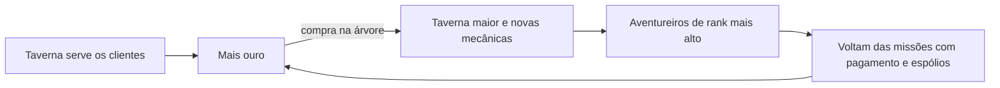

# GDD — Taverna de Aventureiros

> Este arquivo é a versão oficial do GDD. Última atualização: 2 de novembro de 2026.

## Visão geral

Taverna de Aventureiros é um jogo incremental 2D em que uma taverna pequena cresce aos poucos até virar uma guilda de aventureiros, como as de anime, e a história termina com a derrota do Lorde Demônio.

- **Gênero**: incremental/idle com leve gestão.
- **Plataformas**: Android (APK/AAB) e desktop (Windows), com o mesmo código.
- **Público**: jogadores casuais de celular e a comunidade de incrementais da Steam.
- **Fantasia central**: ver uma taverna simples virar a guilda que salva o mundo.
- **Ritmo**: o jogo é contínuo, sem runs: a taverna não abre e fecha em sessões, porque os aventureiros precisam sair em missão e voltar depois.
- **Sem aleatoriedade nas missões**: o aventureiro nunca morre nem falha; ele sempre volta.
- **Fim**: ao derrotar o Lorde Demônio, o mundo entra em paz e o jogo acaba, sem modo infinito nem recomeço.

## Controles

Tudo no jogo se faz com um toque (celular) ou um clique (desktop): não há personagem para mover nem comandos de teclado obrigatórios.

- **Uma ação, um toque**: servir, contratar, comprar habilidade, coletar ouro.
- **Sistema**: configurações (música, efeitos, tela cheia, sombras, FPS), minimizar, estatísticas, créditos, salvar, apagar progresso com confirmação e sair. Esc abre e fecha o menu.
- **Mesmo comportamento nas duas plataformas**: o motor traduz toque e clique para a mesma ação genérica, e o Lua nunca sabe qual foi.
- **Botões grandes**: alvos de toque com pelo menos 48 px, pensando no polegar.
- **Sem gestos difíceis**: nada de arrastar com precisão, pinça ou toque duplo como única forma de fazer algo. Rolagem de listas é o único arraste.
- **Tela**: o jogo é sempre na horizontal (16:9), com a taverna ocupando a tela principal e a evolução em abas separadas. No computador abre em tela cheia (F11 ou Alt+Enter alternam com o modo janela); no celular fica travado na horizontal.
- **Feedback imediato**: todo toque gera resposta visual e sonora (número de ouro subindo, brilho no botão).

## Loop principal

O ouro da taverna compra habilidades na árvore, que ampliam a taverna e liberam novas mecânicas. Aventureiros melhores fazem missões mais caras e trazem mais ouro.

## Telas

- **Taverna (tela principal)**: mostra só a taverna, sem o painel lateral de melhorias. Ela cresce visualmente e ganha novas áreas com o tempo.
- **Árvore de habilidades (aba)**: árvore em que comprar um item abre os próximos, como na maioria dos incrementais. É aqui que o jogador compra melhorias e libera as novas mecânicas.
- **Mercadinho (aba)**: abre com a área de espólios; depois ganha a parte de venda.
- **Aventureiros (aba)**: contratação, evolução e parties.
- **Propaganda (aba ou ramo da árvore)**: fama dos heróis e reputação da taverna.

## Economia

**Tudo custa ouro.** A reputação não é gasta como dinheiro: ela é um nível da taverna que sobe sozinho e atrai aventureiros de rank mais alto.

| Fonte | Como gera ouro | Quando abre |
| --- | --- | --- |
| Consumo | Clientes e aventureiros comem e bebem | Desde o início |
| Missões | Quem contratou a missão paga; a taverna só recebe quando o aventureiro volta com ela concluída, não quando ele a pega | Prateleira de missões |
| Espólios | A taverna compra os espólios dos aventureiros e eles são revendidos sozinhos, com pouco lucro no início | Mercadinho |
| Venda | Poções, armaduras e armas vendidas no mercadinho aumentam muito o lucro | Aba de venda |
| Produção própria | O jardim produz os alimentos, o cozinheiro prepara a comida e a taverna faz as próprias bebidas | Plantação |

**Comemoração**: herói que volta de missão gasta mais que o normal na taverna, então cada missão cumprida gera um pico de renda.

**Ideia a avaliar**: espólios raros virarem ingredientes de pratos especiais.

## Missões

- **Ranks**: F, E, D, C, B, A, S e SS. O SSS existe só como a missão final.
- **Como abrem**: cada rank é comprado na árvore de habilidades.
- **Como funcionam**: aventureiros pegam a missão na prateleira sozinhos, saem, voltam depois de um tempo e trazem o pagamento.
- **Sem espólios no início**: a prateleira rende só o pagamento até o mercadinho abrir.
- **Rank e espólios**: missões de rank mais alto trazem mais espólios.

## Mercadinho

Uma área nova da taverna, construída e melhorada do rank F ao SS.

1. **Compra de espólios**: ao voltar, os aventureiros vendem seus itens no mercadinho. A revenda é automática e dá pouco lucro, para a área já render desde a abertura.
2. **Aba de venda**: mais tarde, o jogador passa a vender poções, armaduras e armas, com lucro bem maior.

## Árvore de habilidades

Todas as melhorias ficam na árvore: comprar uma habilidade abre as próximas. Os ramos são:

| Ramo | O que melhora |
| --- | --- |
| Salão | Mesas, cadeiras e novas áreas da taverna |
| Clientes | Frequência e quantidade de clientes |
| Serviço | Garçons, cozinheiro, bardo e velocidade de atendimento |
| Bebidas e comida | Rentabilidade, jardim, comida do cozinheiro e bebidas próprias |
| Guilda | Prateleira de missões, ranks e quantidade de aventureiros |
| Mercadinho | Espólios e vendas |
| Heróis | Recrutador, contratação, parties, propaganda e invocação |

As imagens de referência do visual da árvore ainda serão enviadas.

## Ordem de desbloqueio

O jogo começa simples e libera uma coisa de cada vez, para cada desbloqueio virar um momento de novidade.

1. **Taverna**: poucos clientes, misturando pessoas comuns e aventureiros; mesas, garçons e bebidas.
2. **Prateleira de missões**: começa no rank F, e os seguintes abrem pela árvore.
3. **Mercadinho**: compra e revenda automática de espólios.
4. **Aba de venda**: poções, armaduras e armas.
5. **Produção própria**: jardim, cozinheiro e bebidas da casa.
6. **Aventureiros contratados**: contratação e investimento em armadura, arma e magia.
7. **Parties**: grupos de 4 aventureiros vão juntos nas missões.
8. **Heróis e propaganda**: um contratado evolui até virar herói, o que abre a propaganda.
9. **Invocação isekai**: heróis de outro mundo, com atributos maiores que os dos contratados.
10. **Missão final SSS**: uma party de 4 heróis invocados derrota o Lorde Demônio e o jogo acaba.

O ritmo exato (quanto ouro para cada etapa) fica para o balanceamento, já nos scripts em Lua.

## Aventureiros e heróis

| Tipo | Como chega | O que faz |
| --- | --- | --- |
| Clientes comuns | Sozinhos | Comem, bebem e vão embora |
| Aventureiros comuns | Sozinhos | Pegam missões, voltam e vão embora |
| Contratados | O jogador contrata | Evoluem com investimento em armadura, arma e magia, formam parties e podem virar heróis |
| Invocados | Invocação isekai, no fim do jogo | Têm os maiores atributos e continuam evoluindo; 4 deles são exigidos na missão final |

**Funcionários ligados aos aventureiros**: o recrutador ajuda na contratação de aventureiros, e o bardo espalha a fama dos heróis, reforçando a propaganda.

**Propaganda e reputação**: a propaganda abre quando o primeiro contratado vira herói. Ela dá fama aos heróis, a fama traz reputação para a taverna, e a reputação atrai aventureiros de rank mais alto, que geram mais lucro.

**Brigas entre clientes**: combinam com o clima de aventureiros e fazem parte do jogo. Clientes de temperamentos incompatíveis na mesma mesa podem brigar. A briga atrapalha um pouco a taverna, mas o jogador pode separá-la com um toque e ganha uma recompensa por isso, para ser um momento divertido e não uma punição.

**Eventos e personalidades**:

- Histórias e fofocas: a cada 12 missões, um relato aumenta o pagamento das missões por 1 minuto.
- Personalidades: guerreiro e arqueiro na mesma mesa brigam; mago e clérigo geram bônus de consumo.
- Tom: humor leve, para cada evento ser divertido de ler em poucos segundos.

## Final do jogo

A última missão é a SSS: derrotar o Lorde Demônio. Para isso, o jogador invoca quatro heróis e forma uma party com eles. Quando eles vencem, o mundo entra em paz e o jogo acaba.

O prestígio da versão anterior (vender a taverna e recomeçar em outra cidade) saiu do jogo com esta decisão.

## Monetização

O plano é lançar uma demo no itch.io, depois vender na Steam e ter uma versão gratuita com anúncios recompensados no celular.

| Canal | Modelo | Observações |
| --- | --- | --- |
| itch.io | Demo gratuita | Testar e coletar feedback antes do lançamento |
| Steam | Pago, cerca de US$ 3 a 5 | Taxa de US$ 100 por jogo, recuperável após certas vendas |
| Celular | Grátis + anúncios recompensados + compras opcionais | Ex.: assistir um anúncio para dobrar o ouro por 1 hora |

Publicar na Play Store exige o formato AAB e proíbe baixar código novo por fora da loja; a atualização de scripts em Lua vale só para testes e distribuição por fora.

## Tecnologia

O jogo usa um motor em C++ com raylib e toda a lógica em scripts Lua, compilado para Windows e Android a partir do mesmo código.

| Camada | Linguagem | Responsabilidade |
| --- | --- | --- |
| Motor | C++ (raylib) | Janela, desenho, som, toque/clique, interpretador Lua, download de scripts |
| Jogo | Lua | Economia, heróis, missões, upgrades, menus, eventos |
| Builds | GitHub Actions | Gera o .exe (com scripts embutidos) a cada mudança; o APK vem depois |

- **Atualização em teste**: no computador, o jogo é um único .exe com os scripts e as fontes embutidos; ao abrir, confere a versão no GitHub e se substitui pela nova. No Android, a ideia é baixar só os scripts Lua.
- **APK novo só quando o motor muda**: assinado sempre com a mesma chave, instalado por cima do anterior.
- **Entrada unificada**: toque e clique viram as mesmas ações antes de chegar ao Lua.
- **Desempenho**: se alguma parte pesar em Lua, ela é movida para o C++.

## Questões em aberto e próximos passos

- [x] Conectar a conta do GitHub e criar o repositório.
- [x] Montar o motor base em C++ com raylib e Lua.
- [x] Configurar o build automático do .exe com atualização automática.
- [ ] Deixar o repositório público (necessário para as atualizações chegarem).
- [x] Estilo visual: 3D low poly, com personagens sem rosto e câmera fixa de cima (referências em `docs/estilo-visual.md`).
- [ ] Decidir o nome final do jogo.
- [ ] Balancear os primeiros 30 minutos de jogo (custos e ganhos iniciais).
- [ ] Enviar as imagens de referência da árvore de habilidades.
- [x] Refazer a interface: taverna em tela cheia e abas.
- [x] Criar a árvore de habilidades e mover para ela as melhorias atuais.
- [x] Adicionar clientes comuns, além dos aventureiros.
- [x] Implementar as mecânicas deste documento (branch `jogo-3d`, para avaliação).
- [ ] Testar no Windows e ajustar o balanceamento (o robô de teste é a primeira referência de ritmo).
- [ ] Trocar a árvore pelas imagens de referência, quando chegarem.
- [ ] Versão Android (APK) na horizontal.
