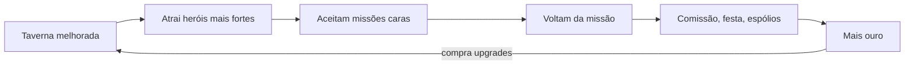

# GDD — Taverna de Aventureiros

> Cópia do GDD de 1º de novembro de 2026. A versão editável fica em [Claude Docs](https://claude.ai/artifact/NawRpwFGyEyQge2Ltqta79).

## Visão geral

Taverna de Aventureiros é um jogo incremental 2D em que o jogador gerencia uma taverna que contrata heróis, intermedeia missões e lucra com tudo que passa por ela.

- **Gênero**: incremental/idle com leve gestão.
- **Plataformas**: Android (APK/AAB) e desktop (Windows), com o mesmo código.
- **Público**: jogadores casuais de celular e a comunidade de incrementais da Steam.
- **Fantasia central**: ver uma taverna simples virar o ponto de encontro mais famoso do reino.

## Controles

Tudo no jogo se faz com um toque (celular) ou um clique (desktop): não há personagem para mover nem comandos de teclado obrigatórios.

- **Uma ação, um toque**: contratar, aceitar missão, comprar upgrade, coletar ouro.
- **Mesmo comportamento nas duas plataformas**: o motor traduz toque e clique para a mesma ação genérica, e o Lua nunca sabe qual foi.
- **Botões grandes**: alvos de toque com pelo menos 48 px, pensando no polegar.
- **Sem gestos difíceis**: nada de arrastar com precisão, pinça ou toque duplo como única forma de fazer algo. Rolagem de listas é o único arraste.
- **Tela**: o jogo é sempre na horizontal (16:9), com o salão à esquerda e o painel de ouro e melhorias à direita. No computador abre em tela cheia (F11 ou Alt+Enter alternam com o modo janela); no celular fica travado na horizontal.
- **Feedback imediato**: todo toque gera resposta visual e sonora (número de ouro subindo, brilho no botão).

## Loop principal

A taverna melhor atrai heróis mais fortes, que aceitam missões mais caras e voltam gerando comissão, comemoração e espólios; esse ouro paga os próximos upgrades.

## Economia

Quem paga as missões são os clientes, não a taverna: ela é a intermediária e ganha ouro de três fontes.

| Fonte | Como gera ouro | Quando acontece |
| --- | --- | --- |
| Comissão | Clientes pagam para pendurar pedidos no quadro; a taverna fica com uma porcentagem da recompensa | A cada missão cumprida |
| Consumo | Heróis comem, bebem e alugam quartos enquanto estão na taverna | Contínuo (renda passiva) |
| Espólios | Heróis voltam com itens; a taverna compra barato e revende ou usa | Na volta de cada missão |

**Comemoração**: herói que volta de missão bem-sucedida gasta bem mais que o normal, então cada missão cumprida gera um pico duplo (comissão + festa).

**As fontes conversam entre si**:

- Espólios raros viram ingredientes de pratos especiais, que aumentam o consumo.
- Heróis bem alimentados e descansados falham menos, o que protege a comissão.
- Missões perigosas pagam comissão menor, mas trazem espólios melhores.

**Patrocínio**: a taverna pode pagar o equipamento de um herói em troca de uma fatia maior da recompensa. Se ele falhar, o investimento é perdido.

## Upgrades

Cada categoria de upgrade alimenta uma parte diferente do loop, para o jogador alternar o foco.

| Categoria | Exemplos | O que melhora |
| --- | --- | --- |
| Espaço | Mesas, quartos, salão maior | Mais heróis ao mesmo tempo |
| Cardápio e bar | Pratos, bebidas, ingredientes raros | Gasto por visita (consumo) |
| Quadro de missões | Missões de nível mais alto | Comissões maiores, exige heróis melhores |
| Reputação | Fama da taverna | Heróis mais fortes e clientes mais ricos |
| Funcionários | Bardo, cozinheiro, recrutador | Felicidade, consumo e automação |

Os funcionários são a principal fonte de automação: o recrutador, por exemplo, traz heróis sem o jogador precisar tocar.

## Ordem de desbloqueio

O jogo começa com uma única fonte de ouro e libera as outras aos poucos, para cada desbloqueio virar um momento de novidade.

1. **Consumo**: a taverna vazia, um herói por vez, toque para servir e coletar ouro.
2. **Espaço**: primeiras mesas e quartos, mais heróis simultâneos.
3. **Quadro de missões**: heróis passam a sair em missões; entra a comissão e a comemoração na volta.
4. **Espólios**: missões começam a trazer itens para vender ou usar.
5. **Funcionários**: automação começa (recrutador, cozinheiro, bardo).
6. **Patrocínio e reputação**: decisões de risco e heróis de nível alto.
7. **Prestígio**: liberado quando a primeira taverna atinge o auge.

O ritmo exato (quanto ouro para cada etapa) fica para o balanceamento, já nos scripts em Lua.

## Heróis e eventos

Os heróis são o que dá personalidade ao jogo e o diferencia de outros incrementais de guilda.

- **Histórias e fofocas**: heróis voltam com relatos que viram eventos na taverna (um dragão avistado abre missões novas, uma briga entre guildas muda os preços).
- **Personalidades**: cada cliente tem um temperamento; colocar os errados na mesma mesa causa briga, os certos geram combos de consumo.
- **Evolução**: heróis ganham nível com missões cumpridas e passam a aceitar missões mais caras.
- **Tom**: humor leve, para cada evento ser divertido de ler em poucos segundos.

## Prestígio

O prestígio é vender a taverna e abrir outra em uma nova cidade, recomeçando a economia mas mantendo a reputação.

- A reputação acumulada vira um bônus permanente (heróis melhores e clientes mais ricos desde o início).
- Cada cidade nova pode trazer um tipo diferente de missão ou cliente, renovando o interesse.
- Ideia a avaliar: alguns heróis favoritos podem seguir o jogador para a nova taverna.

## Monetização

O plano é lançar uma demo no itch.io, depois vender na Steam e ter uma versão gratuita com anúncios recompensados no celular.

| Canal | Modelo | Observações |
| --- | --- | --- |
| itch.io | Demo gratuita | Testar e coletar feedback antes do lançamento |
| Steam | Pago, cerca de US$ 3 a 5 | Taxa de US$ 100 por jogo, recuperável após certas vendas |
| Celular | Grátis + anúncios recompensados + compras opcionais | Ex.: assistir um anúncio para dobrar o ouro por 1 hora |

Publicar na Play Store exige o formato AAB e proíbe baixar código novo por fora da loja; a atualização de scripts em Lua vale só para testes e distribuição por fora.

## Tecnologia

O jogo usa um motor em C++ com raylib e toda a lógica em scripts Lua, compilado para Windows e Android a partir do mesmo código.

| Camada | Linguagem | Responsabilidade |
| --- | --- | --- |
| Motor | C++ (raylib) | Janela, desenho, som, toque/clique, interpretador Lua, download de scripts |
| Jogo | Lua | Economia, heróis, missões, upgrades, menus, eventos |
| Builds | GitHub Actions | Gera o .exe (com scripts embutidos) a cada mudança; o APK vem depois |

- **Atualização em teste**: no computador, o jogo é um único .exe com os scripts e as fontes embutidos; ao abrir, confere a versão no GitHub e se substitui pela nova. No Android, a ideia é baixar só os scripts Lua.
- **APK novo só quando o motor muda**: assinado sempre com a mesma chave, instalado por cima do anterior.
- **Entrada unificada**: toque e clique viram as mesmas ações antes de chegar ao Lua.
- **Desempenho**: se alguma parte pesar em Lua, ela é movida para o C++.

## Questões em aberto e próximos passos

- [x] Conectar a conta do GitHub e criar o repositório.
- [x] Montar o motor base em C++ com raylib e Lua.
- [x] Configurar o build automático do .exe com atualização automática.
- [ ] Deixar o repositório público (necessário para as atualizações chegarem).
- [ ] Definir o estilo visual (pixel art, ilustrado, minimalista).
- [ ] Decidir o nome final do jogo.
- [ ] Balancear os primeiros 30 minutos de jogo (custos e ganhos iniciais).
- [ ] Decidir se heróis seguem o jogador no prestígio.
- [ ] Próxima etapa: quadro de missões.
- [ ] Versão Android (APK) na horizontal.
